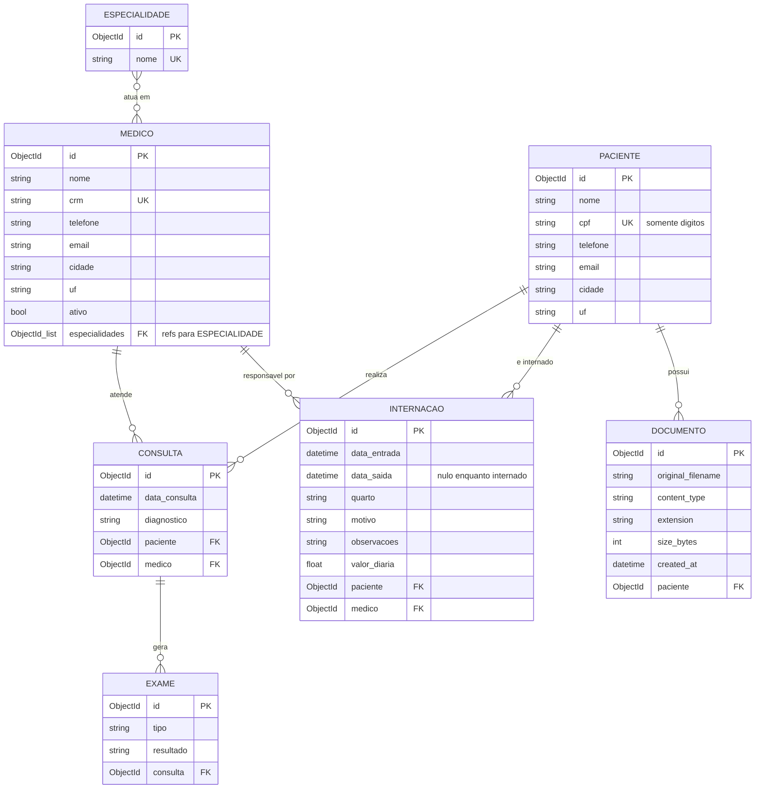
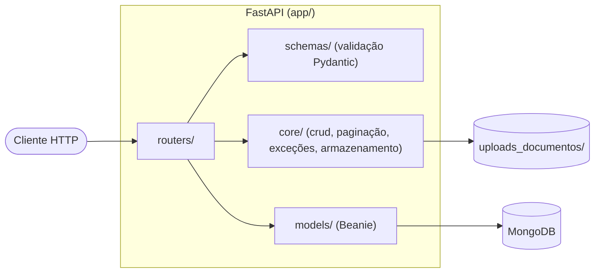

# Sistema de Gestão Hospitalar

API REST para gestão hospitalar desenvolvida para a disciplina de **Persistência (2026.1)**.
Stack: **Python 3.12**, **FastAPI**, **Beanie ODM** sobre **MongoDB** (driver assíncrono `pymongo`) e **uv** para dependências.

Módulos: pacientes, médicos, especialidades, consultas, exames, internações e documentos (upload/download de PDF e imagens).

---

## Estrutura

```text
├── app/
│   ├── core/            # config (pydantic-settings), exceções globais, utilitários, validadores, armazenamento de arquivos
│   ├── db/db.py         # cliente MongoDB, init_db() / close_db()
│   ├── models/          # documentos Beanie + índices (lista única em MODELOS)
│   ├── schemas/         # schemas Pydantic de entrada/saída
│   ├── routers/         # endpoints por entidade
│   └── main.py          # aplicação FastAPI
├── tests/
│   ├── unit/            # lógica pura (sem dependências externas)
│   └── api/             # testes de integração (exigem MongoDB)
├── seed.py              # carga inicial com Faker pt_BR
├── .env.example         # modelo de configuração
└── pyproject.toml
```

## Modelo de dados

Coleções do MongoDB e seus relacionamentos (referências `DBRef` do Beanie). `PK` = chave primária (`_id`),
`FK` = referência a outra coleção, `UK` = índice único.



Camadas e fluxo de uma requisição:



## Pré-requisitos

* Python 3.12+ e [`uv`](https://docs.astral.sh/uv/)
* Um MongoDB acessível (local ou Atlas)

```bash
docker run -d --name mongo -p 27017:27017 mongo:7     # opção rápida para desenvolvimento
```

## Como executar

```bash
uv sync                      # instala dependências (inclui o grupo dev: pytest, faker, httpx)
cp .env.example .env         # ajuste MONGODB_URL e DATABASE_NAME
python seed.py               # (opcional) popula o banco — APAGA as coleções, pede confirmação e verifica o resultado
uvicorn app.main:app --reload
```

* API: <http://127.0.0.1:8000> · Swagger: <http://127.0.0.1:8000/docs> · Saúde: `GET /health`

> Não há migrações: o MongoDB não tem esquema fixo. Os **índices** (únicos e de relacionamento) são criados
> automaticamente na inicialização (`init_beanie`). Os índices nas referências (`paciente.$id`, `medico.$id` etc.) são criados em `app/db/db.py` e, se o servidor recusar algum, a aplicação apenas registra um aviso.

### Variáveis de ambiente

| Variável | Padrão | Descrição |
|---|---|---|
| `MONGODB_URL` | — (obrigatória) | String de conexão |
| `DATABASE_NAME` | — (obrigatória) | Nome do banco |
| `MONGODB_TIMEOUT_MS` | `5000` | Tempo máximo para selecionar servidor |
| `UPLOAD_DIR` | `uploads_documentos` | Pasta dos documentos enviados |
| `MAX_UPLOAD_BYTES` | `10485760` | Tamanho máximo de upload (10 MB) |

### Seed

`python seed.py [--yes] [--quantidade N]` recria o banco com N registros por entidade (padrão 100; 10 especialidades),
remove os arquivos de documentos órfãos e, ao final, **verifica o que foi gravado**: contagens, unicidade de CPF/CRM e se
toda referência aponta para um documento existente. Termina com código de saída 1 se encontrar problemas.

O `.env` está no `.gitignore`: **nunca versione credenciais** (principalmente do Atlas).

## Endpoints

| Recurso | Rotas |
|---|---|
| Especialidades | `POST/GET /especialidades/`, `GET/PUT/DELETE /especialidades/{id}` |
| Médicos | `POST/GET /medicos/`, `GET /medicos/count`, `GET/PUT/DELETE /medicos/{id}` — filtros: `cidade`, `uf`, `especialidade_id`, `ativo` |
| Pacientes | `POST/GET /pacientes/`, `GET /pacientes/count`, `GET/PUT/DELETE /pacientes/{id}` |
| Consultas | `POST/GET /consultas/`, `GET /consultas/count`, `GET/PUT/DELETE /consultas/{id}` — filtros: `paciente_id`, `medico_id`, `data_inicio`, `data_fim`, `diagnostico` |
| Exames | `POST/GET /exames/`, `GET /exames/count`, `GET/PUT/DELETE /exames/{id}` — filtro: `consulta_id` |
| Internações | `POST/GET /internacoes/`, `GET /internacoes/count`, `GET/PUT/DELETE /internacoes/{id}` — filtro: `paciente_id` |
| Documentos | `POST/GET /pacientes/{id}/documents`, `GET/DELETE /documents/{id}`, `GET /documents/{id}/download` |

Convenções:

* **Paginação** com [`fastapi-pagination`](https://uriyyo-fastapi-pagination.netlify.app/) em todas as listagens: `?page=1&size=50` (`page` ≥ 1, `size` de 1 a 100). A resposta é `{"items": [...], "total": N, "page": 1, "size": 50, "pages": M}`, ordenada por `_id`.
* **Erros** em JSON: `404` (`erro`/`detail`), `400` regra de negócio, `409` valor duplicado (CPF, CRM, nome de especialidade), `413` upload grande demais, `422` validação / id inválido.
* **Integridade**: não é possível excluir paciente/médico com consultas ou internações, consulta com exames, nem especialidade em uso. Excluir um paciente remove seus documentos.
* **Uploads**: apenas PDF, JPEG, PNG e WebP; o conteúdo é conferido pela assinatura do arquivo, a extensão vem do tipo (não do nome enviado) e o arquivo é gravado em blocos, respeitando `MAX_UPLOAD_BYTES`.
* CPF é validado (dígitos verificadores) e armazenado só com dígitos; `uf` é normalizada em maiúsculas. Datas sem fuso são tratadas como UTC.

## Testes

```bash
python -m unittest discover -s tests/unit -t .   # lógica pura, sem dependências
uv run pytest                                      # tudo (API + seed); os testes de API são pulados se não houver MongoDB
TEST_MONGODB_URL=mongodb://localhost:27017 uv run pytest   # apontando para outro MongoDB
```

Os testes de API (incluindo a execução do seed) usam um banco temporário (`hospital_test_xxxx`), removido ao final.

## Mudanças de contrato em relação à versão anterior

* `POST` de criação agora responde **201** (antes 200).
* `PUT` de médicos e internações devolve o recurso atualizado (antes só `{"message": ...}`).
* Médicos: `especialidades` é sempre uma lista de `{id, nome}` (antes variava entre nomes e ids conforme a rota).
* `PUT /consultas/{id}` é parcial (campos omitidos são mantidos); `data_consulta` pode ser informada na criação.
* `POST /internacoes/` agora valida o corpo (campos obrigatórios, `valor_diaria >= 0`, `data_saida >= data_entrada`).
* `GET /medicos/estatisticas/count` continua existindo, porém marcada como *deprecated* (use `/medicos/count`).
* **Listagens retornam `Page`** (`{items, total, page, size, pages}`) em vez de uma lista simples, com `page`/`size` na query.
* Índices únicos em `cpf`, `crm` e `nome` da especialidade: bancos com duplicatas existentes precisam ser limpos antes da primeira inicialização.
